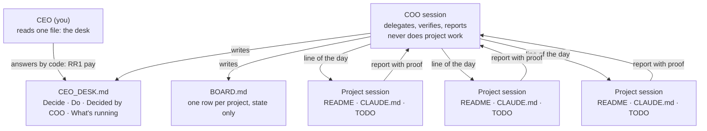

# coo-for-claude-code

An operating layer for running many Claude Code sessions as a team: one person who decides (the CEO), one
session that runs the others (the COO), and one session per project. It is the system I use every day with
fourteen project sessions; this repository is the generic version, with the rules, the file formats, the
hooks and the measurements.

The model and the agent loop are Anthropic's. What is here is the organisation around them: who decides
what, what each session writes and where, and the checks that keep it honest. **Nothing in this repository
calls a model.** Hooks, checks and measurements are plain Python, standard library only.

## The shape

- **The CEO reads one file.** The desk lists only what needs the CEO, by action and by weight: red decisions
  with a recommendation and a deadline, manual actions with the minutes they take, the yellow decisions the COO
  took (cancellable), and a generated one-line-per-project view at the bottom.
- **The COO never does project work.** It writes each session its line for the day (goal, expected proof,
  limits), verifies every report against the repository, keeps the board, and writes the desk.
- **Every project has three files:** `README.md` (what is where), `CLAUDE.md` (rules, the goal and its «done»,
  the lines for the COO), `TODO.md` (the line of the day, the autonomous queue, «Done» with proofs).
- **Three levels of decision.** Red, only the CEO: money, accounts, messages to third parties, production,
  goals. Yellow, the COO decides, writes it down, the CEO can cancel it: anything reversible inside a project.
  Green: fixes, tests and runs, which never reach the desk.
- **Sessions pull work, the COO does not push it.** When a session finishes a line it takes the next one it can
  do without the CEO, and stops only in front of a red decision, third-party data, a cost or a permission.

## What is in the repository

| Path | What it does |
|---|---|
| `hooks/report_to_coo.py` | Stop hook for project sessions. In a turn opened by the COO, if the session wrote more than a closing line after its report, the turn is blocked until that text is sent to the COO too. Without it, proposals died in a chat nobody reads. |
| `hooks/keep_working.py` | Stop hook for project sessions. While the TODO's «Autonomous queue» has open items, the turn does not end: the session gets the next item. Paused by a file, skips items marked `[waiting]`, and lets go after three re-runs without a new commit, so it cannot spin in place. |
| `scripts/check_board.py` | Checks the shape of the board and of the desk: cell caps, who we are waiting for, sections and their order, codes, the four parts of a red item, the minutes of a manual action, expired yellows. Exits 1 on defects; use it as a pre-commit hook. |
| `scripts/board_status.py` | Generates the desk's «What's running» section from the board. |
| `scripts/method_metrics.py` | Measures the method from the COO's transcripts: rounds per day on desk items, share of answers that are just «ok», share that are questions, rounds older than 24 hours. |
| `templates/` | A COO `CLAUDE.md`, a project `CLAUDE.md`, a board, a desk, a TODO and the hook settings, with fake but realistic content. They pass the same checks. |
| `docs/ARTICLE.md` | The write-up: why, how, what broke and the first week's numbers. |

## Measuring the method

A desk is doing its job when the CEO answers little and answers fast. `method_metrics.py` pairs every desk
code the COO writes with the CEO's answer that mentions it:

| Measure | Threshold | When it is over |
|---|---|---|
| Rounds per day | under 20 | the CEO is asked too much |
| Answers that are just «ok» | under 20% | those items could have been yellow |
| Answers that are a question | under 15% | items arrive unfinished or not self-contained |
| Rounds older than 24 hours | under 5% | items sit on the desk |

The first week's numbers were over every threshold; they are in [the article](docs/ARTICLE.md).

## Setting it up

Requirements: Python 3.10 or later, Claude Code with sessions that can message each other (the hooks read
cross-session messages from the transcript), and git in every project folder.

1. Clone this repository somewhere stable and copy `coo.config.example.json` to `coo.config.json`. Set
   `coo_session_id` to the id of your COO session, `board` and `desk` to where those files live, and
   `transcripts_dir` to the folder of the COO session's transcripts.
2. Create the COO folder with `CLAUDE.md` from `templates/CLAUDE.coo.md`, plus `coo/BOARD.md` and
   `coo/CEO_DESK.md` from the templates. Keep the desk out of git if it will hold anything private.
3. In each project folder, write the three files from `templates/CLAUDE.project.md` and `templates/TODO.md`,
   and add the hooks to `.claude/settings.local.json` as in `templates/settings.local.json`, with the real path
   to this repository.
4. Add `python /path/to/coo-for-claude-code/scripts/check_board.py` as a pre-commit hook where the board lives.
5. Once a week, run `python scripts/method_metrics.py list` to find the COO's transcripts, then
   `python scripts/method_metrics.py analyze <prefix>` and compare with the thresholds.

Tests: `python -m pytest`.

The hooks read the transcript format of Claude Code as of October 2026. If a release changes it, the hooks
stop blocking rather than block wrongly: every failure path lets the turn end.

## What is not here yet

A registry of idle and blocked sessions, usage per session and per model, and compaction measurements. They
run in my setup and will come here once they are generic enough.

## License

MIT, see [LICENSE](LICENSE).
